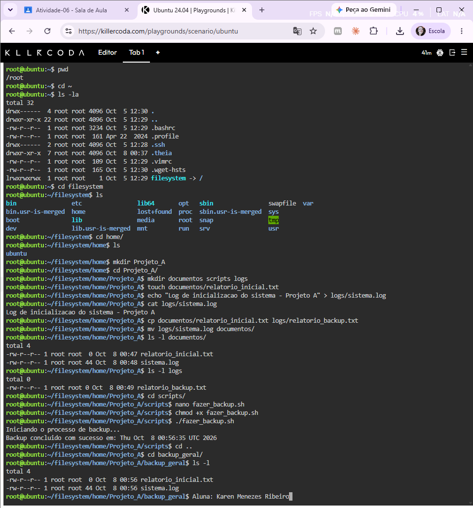
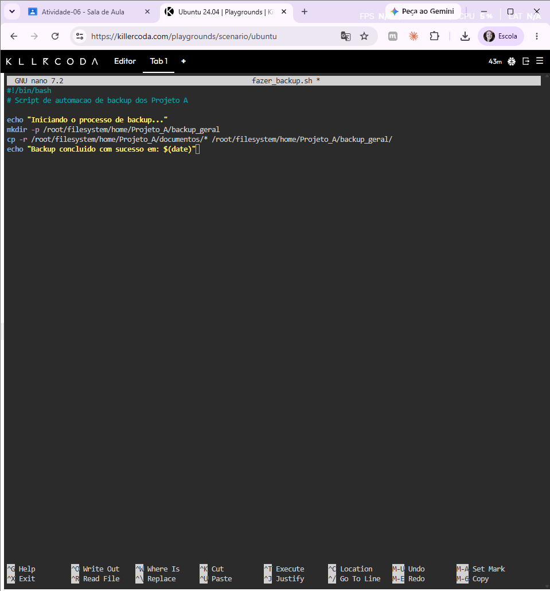

# Atividade 06 - Gerenciamento de Arquivos e Diretórios no Linux

**Aluna:** Karen Menezes Ribeiro

Esta atividade cobre navegação no sistema de arquivos, criação de diretórios, manipulação de arquivos (criar, copiar, mover, visualizar) e automação de uma cópia de segurança (backup) com um script Shell.

O exercício foi realizado no ambiente Killercoda (Ubuntu 24.04).

## Cenário

Sou administradora de sistemas de uma empresa e precisei organizar a estrutura do **Projeto_A**, gerar arquivos de relatório e log, organizar os arquivos entre diretórios e criar um script para automatizar o backup.

## Etapas realizadas

### 1. Navegação e inspeção do ambiente

```bash
pwd
cd ~
ls -la
```

- `pwd` mostra o diretório atual.
- `cd ~` vai para o diretório pessoal.
- `ls -la` lista todos os arquivos, incluindo os ocultos, com permissões e proprietário.

### 2. Criação da estrutura de diretórios

```bash
mkdir Projeto_A
cd Projeto_A
mkdir documentos logs scripts
ls -l
```

### 3. Criação e edição de arquivos

```bash
touch documentos/relatorio_inicial.txt
echo "Log de inicializacao do sistema - Projeto A" > logs/sistema.log
cat logs/sistema.log
```

- `touch` cria um arquivo vazio.
- `>` redireciona a saída do `echo` para o arquivo.
- `cat` exibe o conteúdo do arquivo.

### 4. Cópia e movimentação

```bash
cp documentos/relatorio_inicial.txt logs/relatorio_backup.txt
mv logs/sistema.log documentos/
ls -l documentos
ls -l logs
```

- `cp` duplica o arquivo e mantém o original.
- `mv` move o arquivo `sistema.log` da pasta `logs` para `documentos`.

### 5. Script de backup

Criei o arquivo `fazer_backup.sh` na pasta `scripts` com o `nano`, dei permissão de execução e executei:

```bash
cd scripts
nano fazer_backup.sh
chmod +x fazer_backup.sh
./fazer_backup.sh
```

Conteúdo do script:

```bash
#!/bin/bash
# Script de automacao de backup dos Projeto A

echo "Iniciando o processo de backup..."
mkdir -p /root/filesystem/home/Projeto_A/backup_geral
cp -r /root/filesystem/home/Projeto_A/documentos/* /root/filesystem/home/Projeto_A/backup_geral/
echo "Backup concluido com sucesso em: $(date)"
```

O script:

- cria o diretório `backup_geral` caso ele não exista (`mkdir -p`);
- copia recursivamente todos os arquivos de `documentos` para `backup_geral`;
- exibe uma mensagem com a data e hora da conclusão.

### 6. Verificação do backup

```bash
cd /root/filesystem/home/Projeto_A/backup_geral
ls -l
```

O diretório `backup_geral` contém as cópias dos arquivos de `documentos`, confirmando que o script funcionou.

## Evidências

Execução completa dos comandos no terminal:



Script `fazer_backup.sh` aberto no editor `nano`:



## Conceitos principais

| Comando | Função |
|---|---|
| `pwd` | Mostra o caminho absoluto do diretório atual |
| `cd` | Muda de diretório (`~` é o diretório pessoal) |
| `ls -la` | Lista arquivos com detalhes, incluindo os ocultos |
| `mkdir` | Cria diretórios |
| `touch` | Cria arquivo vazio |
| `echo ... >` | Grava texto em um arquivo |
| `cat` | Exibe o conteúdo de um arquivo |
| `cp` | Copia arquivos |
| `mv` | Move ou renomeia arquivos |
| `chmod +x` | Dá permissão de execução |
| `./` | Executa um script no diretório atual |

O `#!/bin/bash` (*shebang*) na primeira linha do script indica qual interpretador deve executar o arquivo.
